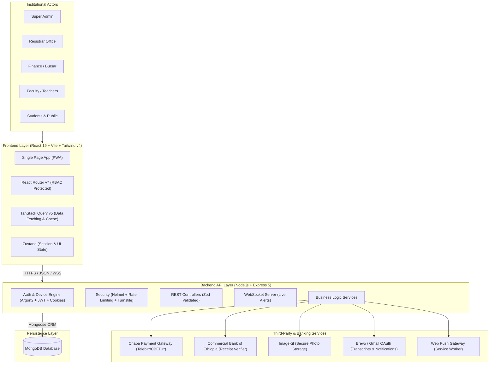

# 🎓 Ethiopian College & University Management System (SMS)

<div align="center">


**A modern, production-grade Higher Education and TVET College Management System engineered for educational institutions with native Ethiopian localized workflows.**

[Key Features](#-key-features) • [System Architecture](#-system-architecture) • [Ethiopian Localization](#-ethiopian-specialized-integrations) • [Getting Started](#-getting-started) • [API & Workspaces](#-role-workspaces) • [Deployment](#-deployment)

</div>

---

## 🌟 Overview

The **College & University SMS** is a full-stack enterprise institutional management platform built specifically to streamline academic operations, multi-program curricula, financial reconciliation, and student life cycle workflows.

Unlike standard generic school systems, it incorporates **end-to-end Ethiopian localization**, including:
- **Ethiopian Ge'ez Calendar engine** integrated with academic terms, attendance, and fee cycles.
- **Direct Commercial Bank of Ethiopia (CBE) Slip Verifier** (automated dual-channel verification for branch deposits, mobile receipts, and QR tokens).
- **Automated Chapa Payment Gateway** for instantaneous digital fees via Telebirr, CBEBirr, AwashBirr, and debit cards.
- **Flexible Academic Structures** supporting Degree, TVET Levels (1–5), and Extension/Continuing Education models.
- **Cryptographic Credential Verification** with dynamic QR-coded Transcripts, Certificates, and Student ID cards.

---

## 🏗️ System Architecture



---

## 🚀 Key Features

### 🏢 1. Super Admin Command Center
- **Institutional Analytics:** Real-time metrics on admissions, revenue velocity, active cohorts, and retention rates.
- **User & Role Governance:** Role-Based Access Control (RBAC) with granular permissions across Admins, Registrars, Accountants, Teachers, and Students.
- **Session & Device Security:** Device fingerprinting with `device-detector-js`, IP geolocation via `geoip-lite`, and instant multi-device revocation.
- **Complete Audit Trail:** Immutable logging of security events, grade adjustments, policy updates, and ledger actions.
- **System Broadcasts:** Institution-wide notifications delivered via Web Push, internal announcements, and email.

### 📜 2. Registrar Office Suite
- **Hierarchical Curriculum Modeling:** Define Departments, Programs (Degree, TVET Levels 1–5, Certificates), Qualification Types, Academic Years, Semesters, and Cohort Batches.
- **Online Admissions Pipeline:** Public prospective student portal, document uploads, application scoring, and automated acceptance workflows.
- **Dynamic Grading Policies:** Authoritative letter grading matrices (A+, A, B, etc.) with customizable GPA grade points, repeating policies (best/latest/all), and rounding precision.
- **Document Generation Center:**
  - Automated official **Student Transcripts** with GPA calculations.
  - Printable **Student ID Cards** embedded with secure QR verification codes.
  - Official **Graduation Certificates** with customized institutional branding.
- **Student Roster Management:** Bulk cohort imports, status tracking (Active, Withdrawn, Suspended, Graduated), and section assignments.

### 💰 3. Finance & Bursar Workspace
- **Payment Cycles & Billing:** Flexible academic billing schedules with recurring monthly tuition, registration fees, and graduation charges.
- **Fee Waivers & Sponsorships:** Partial and complete scholarship allocations with documented justifications.
- **Automated Financial Holds:** Instant administrative locks on student accounts for overdue tuition, restricting exam access and transcript releases.
- **Double-Entry Student Ledgers:** Complete history of charges, deposits, adjustments, and receipts.
- **Real-Time Reconciliation:** Daily transaction auditing, exportable Excel financial reports (`exceljs`), and payment summaries.

### 👩‍🏫 4. Faculty & Teacher Portal
- **Assigned Course Workspace:** Filtered views showing only assigned sections, cohorts, and subjects.
- **Continuous Assessment (CA):** Multi-component grading (Quizzes, Mid-terms, Projects, Final Exams) adhering strictly to Registrar grading policies.
- **Attendance Tracker:** Daily and session-by-session attendance tracking with percentage reporting.
- **Course Material Distribution:** Upload lecture slides, syllabi, and reference material directly to enrolled students.

### 📱 5. Student & Public Portal
- **Self-Service Application Portal:** Prospective students can apply, track their status in real time, and submit prerequisite documentation.
- **Direct Tuition Payment:** Students can pay tuition online in seconds using Telebirr, CBEBirr, or Bank Transfer.
- **Public Credential Verification:** Instant document authenticity verification via public scanning of transcript or ID QR codes.

---

## 🇪🇹 Ethiopian Specialized Integrations

### 1. Dual Calendar Engine (Gregorian & Ethiopian Ge'ez)
The system natively converts between Gregorian and Ethiopian calendars (`ethiopianDate.js`), ensuring:
- Academic deadlines, term start/end dates, and payment cycles support standard Ethiopian calendar months (*Meskerem*, *Tikimt*, *Hidar*, etc.).
- Official student documents and reports display both Gregorian and Ethiopian academic calendars seamlessly.

### 2. Commercial Bank of Ethiopia (CBE) Slip Verifier
Automated fraud prevention against forged bank deposit slips:
- **Dual Verification Engines:** Automatically dispatches lookups to either the CBE Nuxt JSON backend or the Port 100 PDF extraction engine.
- **Multi-Format Input:** Accepts `v2-...` tokens, QR payloads, direct URLs, or branch receipt FT-numbers (`FT...-XXXXXXXX`).
- **Cryptographic Receipt Audit:** Verifies deposit amounts, transaction date, sender account, and transaction reference before releasing enrollment holds.

### 3. Native Chapa Payment Gateway
Production-ready integration with [Chapa](https://chapa.co):
- **Payment Methods:** Telebirr, CBEBirr, AwashBirr, and local debit cards.
- **Zero Race Conditions:** Idempotent transaction processing with SHA-256 HMAC signature verification (`x-chapa-signature`).
- **Instant Receipt Generation:** Auto-generates numbered payment vouchers and clears billing balances immediately upon webhook receipt.

---

## 💻 Tech Stack

| Domain | Technology | Description |
| :--- | :--- | :--- |
| **Frontend Core** | [React 19](https://react.dev) | High-performance UI rendering with concurrent features |
| **Build & Tooling** | [Vite 8](https://vite.dev) | Ultra-fast HMR and optimized production bundling |
| **Styling** | [Tailwind CSS v4](https://tailwindcss.com) | Modern utility-first CSS engine with dynamic tokens |
| **State & Data** | [TanStack Query v5](https://tanstack.com/query) & [Zustand](https://zustand-demo.pmnd.rs) | Server-state caching and lightweight reactive client store |
| **Table & UI** | [TanStack Table v9](https://tanstack.com/table) & [Lucide React](https://lucide.dev) | Headless data grids with rich icon library |
| **Backend Core** | [Node.js](https://nodejs.org) + [Express 5](https://expressjs.com) | Modern async REST server |
| **Database** | [MongoDB](https://www.mongodb.com) + [Mongoose 9](https://mongoosejs.com) | Document database with schema enforcement |
| **Authentication** | [Argon2](https://github.com/ranisalt/node-argon2) + [JWT](https://jwt.io) | Memory-hard password hashing & cryptographically signed tokens |
| **Document Engine**| [PDFKit](https://pdfkit.org) & [Docx](https://docx.js.org) & [ExcelJS](https://github.com/exceljs/exceljs) | Native generation of PDFs, Word transcripts, and Excel spreadsheets |
| **Media & Storage**| [ImageKit](https://imagekit.io) | Cloud storage and image transformations for student IDs & photos |
| **Security** | [Helmet](https://helmetjs.github.io) & [Cloudflare Turnstile](https://www.cloudflare.com/products/turnstile/) | Strict HTTP headers and modern CAPTCHA bot mitigation |
| **Testing** | [Vitest](https://vitest.dev) & [Supertest](https://github.com/ladjs/supertest) | Fast unit and integration testing suite |

---

## 📂 Project Structure

```
sms/
├── client/                     # Frontend Application (React 19 + Vite)
│   ├── public/                 # Static assets, web app manifest, icons
│   ├── src/
│   │   ├── assets/             # Images, logos, SVG badges
│   │   ├── components/         # Reusable UI component library
│   │   │   ├── layout/         # Navigation bars, sidebars, headers per role
│   │   │   ├── registrar/      # Registrar-specific modals and forms
│   │   │   └── ui/             # Buttons, inputs, modals, cards, badges
│   │   ├── lib/                # API client (Axios), date helpers, utilities
│   │   ├── pages/              # Role-specific dashboard views and pages
│   │   │   ├── finance/        # Ledger, billing cycles, collections, reports
│   │   │   ├── portal/         # Public registration & payment checkout
│   │   │   ├── registrar/      # Academic structure, students, GPA, policies
│   │   │   └── teacher/        # Classes, grading marks, attendance, lessons
│   │   ├── store/              # Zustand state stores (Auth, UI, Notifications)
│   │   ├── App.jsx             # Route declarations and RBAC guards
│   │   ├── index.css           # Tailwind CSS imports & theme definitions
│   │   └── main.jsx            # React root mount
│   ├── package.json            # Client dependencies and build scripts
│   ├── vercel.json             # Vercel SPA routing & API proxy rules
│   └── vite.config.js          # Vite config with PWA & React plugins
│
├── server/                     # Backend API Application (Node.js + Express 5)
│   ├── scripts/                # Database seeding & administrative CLI utilities
│   │   ├── academic-setup.js   # Initializes departments, degrees, and levels
│   │   ├── seed-admin.js       # Seeds the root administrator account
│   │   ├── generate-env.js     # Generates secure secrets and VAPID keys
│   │   └── test-mail.js        # Validates Gmail API / SMTP connectivity
│   ├── src/
│   │   ├── config/             # DB connection, permissions matrix, mail setup
│   │   ├── controllers/        # Request handling and response logic
│   │   ├── middleware/         # Auth verification, rate limiting, error handlers
│   │   ├── models/             # Mongoose schemas (Users, Academic, Payments)
│   │   ├── routes/             # Express API routing by functional domain
│   │   ├── services/           # Core business logic, CBE & Chapa processors
│   │   ├── utils/              # Ethiopian date conversion, device & geo parsers
│   │   ├── validators/         # Zod input schemas for server validation
│   │   ├── __tests__/          # Vitest unit and integration test suites
│   │   ├── app.js              # Express app configuration & middlewares
│   │   └── server.js           # Server bootstrap and HTTP listener
│   ├── .env.example            # Environment variables template
│   └── package.json            # Server dependencies and test scripts
│
└── README.md                   # Project documentation
```

---

## ⚡ Getting Started

### Prerequisites
- **Node.js**: `v20.x` or higher
- **MongoDB**: `v6.x` or higher (Local instance or MongoDB Atlas)
- **Package Manager**: `npm` (v10+) or `pnpm`

---

### 1. Clone the Repository
```bash
git clone https://github.com/your-org/sms.git
cd sms
```

---

### 2. Configure Backend Server

```bash
cd server
npm install
```

Create a `.env` file inside `server/` (copy from `.env.example`):
```bash
cp .env.example .env
```

Generate cryptographically secure secrets and VAPID web-push keys:
```bash
npm run gen:env
```

Fill in the required configuration parameters:
```env
PORT=5000
NODE_ENV=development
CLIENT_ORIGIN=http://localhost:5173
MONGODB_URI=mongodb://localhost:27017/sms

# Security
JWT_ACCESS_SECRET=your_generated_jwt_secret
CODE_HMAC_SECRET=your_generated_hmac_secret

# Push Notifications (from npm run gen:env)
VAPID_PUBLIC_KEY=your_vapid_public_key
VAPID_PRIVATE_KEY=your_vapid_private_key
VAPID_SUBJECT=mailto:admin@example.com

# Payment Gateways (Optional for local dev)
CHAPA_PUBLIC_KEY=CHAPUBK_TEST-xxxxxxxxxxxx
CHAPA_SECRET_KEY=CHASECK_TEST-xxxxxxxxxxxx
CHAPA_WEBHOOK_SECRET=your_webhook_secret_hash
```

---

### 3. Seed Database

Run the provided seeding scripts to set up initial academic structures and an administrator:

```bash
# 1. Seed the default super administrator
npm run seed:admin

# 2. Seed default academic structures (Departments, Programs, Grading bands)
npm run academic:setup
```

Start the backend development server:
```bash
npm run dev
# Server will run on http://localhost:5000
```

---

### 4. Configure & Run Client

Open a new terminal window:

```bash
cd client
npm install
```

Verify `client/.env`:
```env
VITE_API_URL=/api
VITE_VAPID_PUBLIC_KEY=your_vapid_public_key
# Optional: Cloudflare Turnstile public key
VITE_TURNSTILE_SITE_KEY=0x4AAAAAA...
```

Start the Vite development server:
```bash
npm run dev
# Client will run on http://localhost:5173
```

Visit **http://localhost:5173** and log in with your seeded administrator credentials!

---

## 🛡️ Role Workspaces & Default Capabilities

```
┌────────────────────────────────────────────────────────────────────────┐
│                        ROLE-BASED WORKSPACES                           │
├─────────────┬──────────────────────────────────────────────────────────┤
│ ADMIN       │ • System Configuration & Global Settings                 │
│             │ • User Management & Access Provisioning                  │
│             │ • Audit Logs, Security Policies & Session Monitor        │
│             │ • Institution-Wide Announcements                         │
├─────────────┼──────────────────────────────────────────────────────────┤
│ REGISTRAR   │ • Academic Structure (Departments, Programs, Levels)     │
│             │ • Admissions & Online Application Review                 │
│             │ • Student Master Roster & Cohort Enrollment              │
│             │ • Authoritative Grading Policy & GPA Calculations        │
│             │ • Generation of Transcripts, Certificates & Student IDs  │
├─────────────┼──────────────────────────────────────────────────────────┤
│ FINANCE     │ • Tuition Fee Structure & Payment Cycles                 │
│             │ • Automated Student Account Holds (Overdue Policies)     │
│             │ • Ledger Tracking, Fee Waivers & Scholarship Grants      │
│             │ • Bank Slip Verification & Chapa Reconciliation          │
│             │ • Financial Reports Export (Excel/PDF)                   │
├─────────────┼──────────────────────────────────────────────────────────┤
│ TEACHER     │ • Assigned Classes & Course Management                   │
│             │ • Assessment Mark Submission (Continuous Assessment)     │
│             │ • Attendance Management                                  │
│             │ • Course Materials & Syllabus Publishing                 │
├─────────────┼──────────────────────────────────────────────────────────┤
│ STUDENT     │ • Personal Academic Progress & Course History            │
│             │ • Online Tuition Settlement via Telebirr / CBEBirr       │
│             │ • Official Grade Reports & Transcript Downloads          │
│             │ • Noticeboard & Class Schedules                          │
└─────────────┴──────────────────────────────────────────────────────────┘
```

---

## 🧪 Testing

The platform features an automated test suite powered by **Vitest** and **Supertest**, covering:
- Signature validation and idempotency for payment gateways (`chapa.test.js`).
- CBE transaction slip pattern matching and multi-format parsing (`cbeVerifier.test.js`).
- Ethiopian date algorithm conversion verification (`dateConversion.test.js`).
- Registrar permissions, grading policy contiguity, and student workflows (`registrar.test.js`).
- Faculty course ownership and continuous assessment policies (`teacher.test.js`).

Run the test suite:
```bash
cd server
npm test
```

---

## 🚢 Deployment

### Production Architecture
- **Client (Frontend):** Deploy to [Vercel](https://vercel.com) or [Cloudflare Pages](https://pages.cloudflare.com).
  - The repository includes a pre-configured `client/vercel.json` with rewrite rules pointing `/api/*` to the backend server.
- **Server (Backend API):** Deploy to [Render](https://render.com), [Railway](https://railway.app), or an Ubuntu VPS.
  - Set `NODE_ENV=production`.
  - Set `TRUST_PROXY=1` (or appropriate proxy hop count).
  - Ensure background workers / webhooks are whitelisted.
- **Database:** [MongoDB Atlas](https://www.mongodb.com/atlas) with automated backups and replica sets.

> [!TIP]
> When deploying on Render Free or similar platforms where standard SMTP ports (25, 465, 587) are restricted, utilize the included **Gmail OAuth2 HTTPS pipeline** (`npm run google:token`) or **Brevo API** for 100% reliable transactional email delivery.

---

## 🔒 Security Best Practices

- **Zero-Secret Client:** Private encryption keys, webhook secrets, and image management keys reside exclusively on the server.
- **Sanitized MongoDB Queries:** Parameterized queries with strict validation schemas prevent NoSQL injection attacks.
- **Strict Password Policies:** Passwords hashed with high-memory **Argon2id**.
- **Timing-Safe Verifications:** Webhook cryptographic signatures are verified using constant-time byte comparisons (`crypto.timingSafeEqual`) to prevent timing side-channel attacks.
- **Turnstile Bot Mitigation:** Protects public login and registration endpoints against brute-force credential stuffing.

---

## 📄 License

This project is licensed under the **ISC License**.

---

<div align="center">
  <sub>Built with ❤️ for modern academic excellence in Ethiopia.</sub>
</div>
