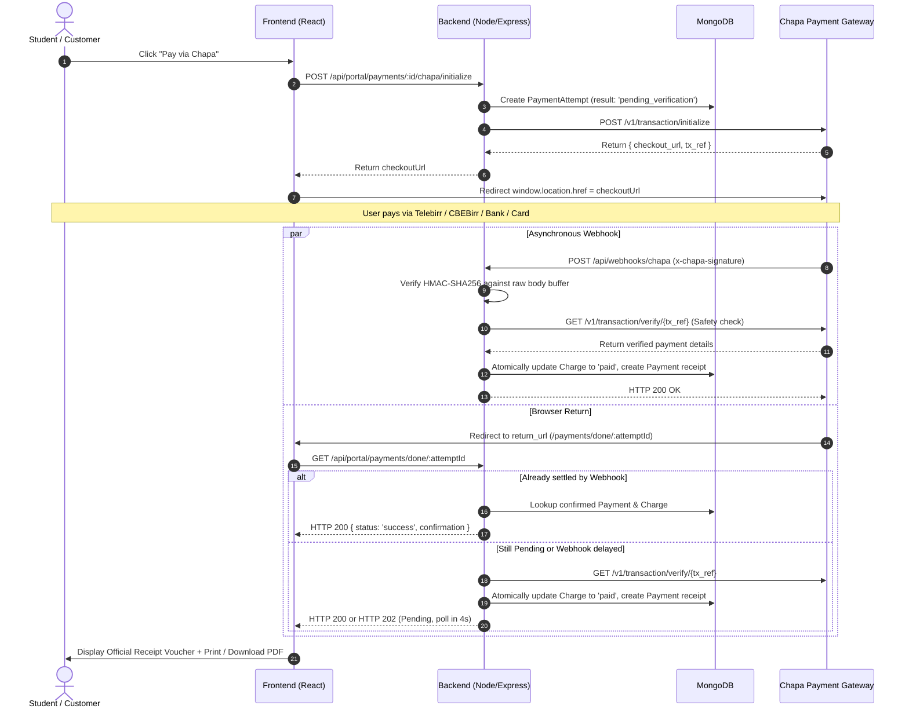

# Master Implementation Prompt: Production Chapa Payment Gateway Integration

> **Role for the AI:** You are a Principal Fintech Backend & Full-Stack Architect. Implement a robust, race-condition-free, idempotent payment integration using **Chapa** (Ethiopia's leading digital payment gateway: Telebirr, CBEBirr, AwashBirr, cards) for a Node.js/Express + MongoDB backend with a React frontend.

---

## 1. System Architecture Overview

The payment flow consists of 4 core phases:
1. **Initialize Phase (API)**: Server generates a unique `tx_ref`, records a `PaymentAttempt` in MongoDB, sanitizes student/user metadata to meet Chapa's strict validation constraints, and calls Chapa Hosted Checkout API (`/transaction/initialize`). Returns `checkoutUrl` to client.
2. **Checkout Phase (Gateway)**: User is redirected to `checkoutUrl` and completes payment via Telebirr, CBEBirr, or card.
3. **Webhook Phase (Server-to-Server)**: Chapa delivers an asynchronous event to `/api/webhooks/chapa`. The server verifies the HMAC-SHA256 signature using raw unparsed bytes in constant time, verifies the status directly with Chapa API (`/transaction/verify/{tx_ref}`), and atomically transitions the database ledger to `paid`.
4. **Browser Return Phase (Client-to-Server)**: User redirects back to `/payment/done/:paymentId`. The server checks the local database first (in case webhook arrived first). If not yet settled, it runs server-to-server verification with Chapa, handles pending statuses gracefully with HTTP 202, and generates an official printable receipt voucher.



---

## 2. Environment Variables & Credentials

Provide these configuration keys in `.env`:

```env
# Chapa Credentials (from https://dashboard.chapa.co)
CHAPA_PUBLIC_KEY=CHAPUBK_TEST-xxxxxxxxxxxxxxxxxxxx
CHAPA_SECRET_KEY=CHASECK_TEST-xxxxxxxxxxxxxxxxxxxx
CHAPA_WEBHOOK_SECRET=your_configured_webhook_secret_hash
CHAPA_WEBHOOK_URL=https://your-api-domain.com/api/webhooks/chapa
CHAPA_API_BASE_URL=https://api.chapa.co/v1
CLIENT_ORIGIN=https://your-frontend-domain.com
```

> **Critical Warning:** If `CHAPA_SECRET_KEY` is omitted or undefined on cloud hosts (e.g., Render, Railway, AWS, Vercel), the application must fail gracefully with HTTP 503 (`CHAPA_NOT_CONFIGURED`) rather than crashing the Node process.

---

## 3. Database Schema Design (MongoDB / Mongoose)

### 3.1 `StudentCharge` (or `Invoice` / `Order`)
Represents the bill or payable balance:
* `amountDue`: Integer in Santims (e.g., `90000` = `900.00 ETB`) to eliminate floating-point precision loss.
* `status`: `'unpaid' | 'paid' | 'waived' | 'overdue'`.
* `dueAt`: Date.
* `paidAt`: Date.
* `payment`: ObjectId referencing `Payment`.
* `isLocked`: Boolean (prevents simultaneous checkout initiations).

### 3.2 `PaymentAttempt` (Audit & Reconciliation Log)
Stores every transaction initialization and verify attempt:
* `charge`: ObjectId referencing `StudentCharge`.
* `parsedReference`: String (The `tx_ref`, indexed for instant lookup).
* `result`: `'pending_verification' | 'success' | 'failed'`.
* `reasonCode`: String (e.g. `'CHAPA_SUCCESS'`, `'CHAPA_PENDING'`, `'AMOUNT_MISMATCH'`).
* `cbeResponse`: Mixed / Object (Raw payload from Chapa verification).
* `ipAddress`: String.
* `createdAt`: Date.

### 3.3 `Payment` (Append-Only Confirmed Ledger)
Stores immutable proof of confirmed payment:
* `receiptNumber`: Unique institutional receipt voucher ID (e.g. `REC-2019-0001-948210`).
* `charge`: ObjectId referencing `StudentCharge` (indexed).
* `amount`: Integer in Santims.
* `method`: `'chapa'`.
* `bankReference`: Chapa reference or transaction ID.
* `chapaReference`: Gateway's unique reference ID (e.g. `CHAPA-REF-xxx`).
* `chapaReceiptUrl`: Link to Chapa's official hosted receipt (`https://checkout.chapa.co/checkout/test-payment-receipt/{ref}`).
* `doneHash`: Crypto random hex token (16 bytes) for public receipt access.
* `payerName`: Name of the payer.
* `status`: `'confirmed'`.
* `paidAt`: Date timestamp of actual settlement.

---

## 4. Chapa Gateway Quirks & Sanitization Constraints

You **must** implement these sanitization rules or Chapa's API will reject the request with HTTP 400 validation errors:

1. **Title Length**: Maximum 26 characters (`title.slice(0, 26)`). Longer strings cause immediate gateway rejection.
2. **Description Length**: Maximum 128 characters (`description.slice(0, 128)`).
3. **Strict Character Whitelist**: Chapa only accepts alphanumeric characters, dots, dashes, underscores, and spaces:
   ```javascript
   const CHAPA_ALLOWED_TEXT = /[^A-Za-z0-9_.\- ]+/g;
   export function sanitizeChapaText(value, limit) {
     if (value == null) return '';
     const cleaned = String(value).replace(CHAPA_ALLOWED_TEXT, ' ').replace(/\s+/g, ' ').trim();
     return limit ? cleaned.slice(0, limit).trim() : cleaned;
   }
   ```
   *Amharic characters, brackets, parentheses, slashes, commas, and emojis MUST be stripped or replaced before sending to Chapa.*
4. **Ethiopian Phone Format**: Chapa rejects international numbers like `+251912345678`. It strictly expects 10 digits starting with `09` or `07` (e.g. `0912345678`).
5. **Axios / SDK Error Masking**: `chapa-nodejs` or Axios collapses 400 validation error bodies into `[object Object]`. Always extract `error.response?.data` to inspect the exact validation message.

---

## 5. Backend Implementation

### 5.1 Raw Body Webhook Middleware (`app.js`)
The webhook route **must** read raw unparsed payload bytes before `express.json()` parses the stream, otherwise HMAC-SHA256 signature verification will fail:

```javascript
// server.js or app.js
import express from 'express';
import { chapaWebhookHandler } from './controllers/chapa.controller.js';

const app = express();

// 1. RAW BODY WEBHOOK ROUTE (BEFORE express.json)
app.post(
  '/api/webhooks/chapa',
  express.raw({ type: 'application/json', limit: '2mb' }),
  chapaWebhookHandler
);

// 2. STANDARD BODY PARSERS FOR ALL OTHER ROUTES
app.use(express.json({ limit: '10mb' }));
app.use(express.urlencoded({ extended: true }));
```

### 5.2 Chapa Service Layer (`services/chapa.service.js`)
Install official SDK: `npm install chapa-nodejs`

```javascript
import crypto from 'node:crypto';
import { Chapa, isAxiosError } from 'chapa-nodejs';
import { StudentCharge, Payment, PaymentAttempt } from '../models/Finance.js';

let chapaClient = null;
export function getChapaClient() {
  if (!process.env.CHAPA_SECRET_KEY) {
    throw new Error('CHAPA_NOT_CONFIGURED');
  }
  if (!chapaClient) {
    chapaClient = new Chapa({ secretKey: process.env.CHAPA_SECRET_KEY });
  }
  return chapaClient;
}

// 1. Initialize Hosted Checkout
export async function initializeHostedPayment({
  amount,
  currency = 'ETB',
  email,
  firstName,
  lastName,
  phone,
  txRef,
  callbackUrl,
  returnUrl,
  customization = {},
}) {
  const chapa = getChapaClient();
  const payload = {
    amount: String(amount),
    currency,
    email: email || 'student@college.edu.et',
    first_name: sanitizeChapaText(firstName || 'Student') || 'Student',
    last_name: sanitizeChapaText(lastName || 'Account') || 'Account',
    phone_number: phone || '',
    tx_ref: txRef,
    callback_url: callbackUrl || process.env.CHAPA_WEBHOOK_URL,
    return_url: returnUrl,
    customization: {
      title: sanitizeChapaText(customization.title || 'College Fee', 26) || 'Fee Payment',
      description: sanitizeChapaText(customization.description || 'College tuition fee', 128) || 'Tuition Fee',
    },
  };

  const response = await chapa.initialize(payload);
  const checkoutUrl = response?.data?.checkout_url || response?.checkout_url;
  if (!checkoutUrl) throw new Error('Chapa did not return a checkout URL');

  return { checkoutUrl, txRef, raw: response };
}

// 2. Verify with Chapa API
export async function verifyChapaTransaction(txRef) {
  const chapa = getChapaClient();
  try {
    const response = await chapa.verify({ tx_ref: txRef });
    return { status: 200, data: response };
  } catch (error) {
    const status = error?.status ?? error?.response?.status ?? 502;
    return { status, data: error?.response?.data || { message: error.message } };
  }
}

// 3. Constant-Time HMAC-SHA256 Webhook Verification
export function verifyChapaWebhookSignature(rawBody, signatureHeader) {
  if (!process.env.CHAPA_WEBHOOK_SECRET || !signatureHeader || !rawBody) return false;
  const expected = crypto
    .createHmac('sha256', process.env.CHAPA_WEBHOOK_SECRET)
    .update(rawBody)
    .digest('hex');

  const sigBuf = Buffer.from(String(signatureHeader), 'utf8');
  const expBuf = Buffer.from(expected, 'utf8');
  if (sigBuf.length !== expBuf.length) return false;
  return crypto.timingSafeEqual(sigBuf, expBuf);
}

// 4. Atomic Database Settlement & Idempotency Rules
export async function processVerifiedChapaPayment({ txRef, verifiedData, ipAddress = '' }) {
  let attempt = await PaymentAttempt.findOne({ parsedReference: txRef });
  let charge = attempt?.charge ? await StudentCharge.findById(attempt.charge) : null;

  if (!charge && txRef.startsWith('TX-CHAPA-')) {
    const parts = txRef.split('-');
    if (parts[2]) charge = await StudentCharge.findById(parts[2]);
  }
  if (!charge) throw new Error('Matching student charge record not found.');

  // Idempotency: Return existing payment if already processed
  if (charge.status === 'paid' && charge.payment) {
    const existing = await Payment.findById(charge.payment).lean();
    if (existing) {
      return {
        status: 'success',
        alreadyPaid: true,
        doneHash: existing.doneHash,
        receiptNumber: existing.receiptNumber,
        payment: existing,
      };
    }
  }

  const chapaStatus = String(verifiedData.status || '').toLowerCase();
  if (chapaStatus !== 'success') {
    if (attempt) {
      attempt.result = chapaStatus === 'pending' ? 'pending_verification' : 'failed';
      attempt.cbeResponse = verifiedData;
      await attempt.save().catch(() => {});
    }
    charge.isLocked = false;
    await charge.save().catch(() => {});
    return {
      status: chapaStatus === 'pending' ? 'pending' : 'failed',
      message: chapaStatus === 'pending' ? 'Payment is still processing.' : 'Payment failed on gateway.',
      verifiedData,
    };
  }

  // Validate Amount & Currency
  const expectedEtb = (charge.amountDue / 100).toFixed(2);
  const receivedEtb = Number(verifiedData.amount).toFixed(2);
  if (receivedEtb !== expectedEtb) {
    throw new Error(`Amount mismatch: expected ${expectedEtb} ETB, got ${receivedEtb} ETB`);
  }
  if (String(verifiedData.currency).toUpperCase() !== 'ETB') {
    throw new Error('Currency mismatch: expected ETB');
  }

  // Generate Receipt & Done Hash
  const randSuffix = Math.floor(100000 + Math.random() * 900000);
  const count = await Payment.countDocuments();
  const receiptNumber = `REC-2019-${String(count + 1).padStart(4, '0')}-${randSuffix}`;
  const doneHash = crypto.randomBytes(16).toString('hex');
  const chapaReference = String(verifiedData.reference || verifiedData.tx_ref || txRef).trim();

  // Create immutable Payment row
  const payment = await Payment.create({
    receiptNumber,
    charge: charge._id,
    student: charge.student,
    amount: charge.amountDue,
    method: 'chapa',
    bankReference: verifiedData.reference || txRef,
    doneHash,
    status: 'confirmed',
    chapaReference,
    chapaReceiptUrl: `https://checkout.chapa.co/checkout/test-payment-receipt/${encodeURIComponent(chapaReference)}`,
    payerName: `${verifiedData.first_name || ''} ${verifiedData.last_name || ''}`.trim(),
    cbeData: verifiedData,
    paidAt: verifiedData.created_at ? new Date(verifiedData.created_at) : new Date(),
  });

  // Mark Charge as paid
  charge.status = 'paid';
  charge.paidAt = new Date();
  charge.payment = payment._id;
  charge.isLocked = false;
  await charge.save();

  if (attempt) {
    attempt.result = 'success';
    attempt.cbeResponse = verifiedData;
    attempt.reasonCode = 'CHAPA_SUCCESS';
    await attempt.save().catch(() => {});
  }

  return { status: 'success', alreadyPaid: false, doneHash, receiptNumber, payment, charge };
}
```

### 5.3 Webhook Controller (`controllers/chapaWebhook.controller.js`)
```javascript
export async function chapaWebhookHandler(req, res) {
  const rawBody = req.body;
  const signature = req.headers['x-chapa-signature'] || req.headers['chapa-signature'];

  if (!rawBody) return res.status(400).send('Missing webhook body');

  const isValid = verifyChapaWebhookSignature(rawBody, signature);
  if (!isValid && process.env.NODE_ENV === 'production') {
    return res.status(401).json({ error: 'INVALID_SIGNATURE' });
  }

  let event = {};
  try {
    event = JSON.parse(rawBody.toString('utf8'));
  } catch {
    return res.status(400).send('Invalid JSON payload');
  }

  const txRef = event.tx_ref || event.trx_ref || event.reference;
  if (!txRef) return res.status(200).json({ received: true, ignored: true });

  // Verification step: verify directly with Chapa API before mutating database
  const chapaVerifyRes = await verifyChapaTransaction(txRef);
  if (chapaVerifyRes.status === 200 && chapaVerifyRes.data) {
    const verifiedData = chapaVerifyRes.data?.data || chapaVerifyRes.data;
    await processVerifiedChapaPayment({ txRef, verifiedData, ipAddress: req.ip || '' });
  }

  return res.status(200).json({ received: true });
}
```

---

## 6. Frontend Return & Polling UX (React)

When Chapa redirects back to `/monthly-payments/done/:paymentId`:
1. Check `GET /api/portal/monthly-payments/done/:paymentId`.
2. If status is `success`, render confirmation and allow printing receipt voucher.
3. If status is `pending` (HTTP 202), display `"Waiting for Chapa confirmation..."` spinner and poll again in 4 seconds.
4. If status is `failed`, display friendly error and offer a return button back to checkout.

---

## 7. Automated Test Suite (Vitest / Jest)

Write unit tests covering:
1. **HMAC-SHA256 Signature Verification**: Accepts matching signature, rejects tampered signature, rejects null/empty header.
2. **Idempotency**: Calling `processVerifiedChapaPayment` multiple times with the same `txRef` does NOT create multiple `Payment` rows.
3. **Amount Tampering**: Rejects when Chapa payload amount does not equal `charge.amountDue / 100`.
4. **Currency Safety**: Rejects non-ETB currencies.
5. **Pending and Failed States**: Gateway pending or failed results do NOT mark `charge.status = 'paid'`.

---

## 8. Summary Checklist for Implementation
- [ ] Registered Chapa webhook endpoint in Chapa Dashboard.
- [ ] Added `CHAPA_SECRET_KEY`, `CHAPA_WEBHOOK_SECRET`, and `CHAPA_WEBHOOK_URL` in environment files.
- [ ] Configured `express.raw()` route before `express.json()` for `/api/webhooks/chapa`.
- [ ] Sanitized `first_name`, `last_name`, `title` (≤26 chars), and `description` (≤128 chars).
- [ ] Normalized phone numbers from `+251...` to `09...`.
- [ ] Implemented database idempotency on `StudentCharge` and `Payment`.
- [ ] Handled concurrent return and webhook arrivals gracefully.
